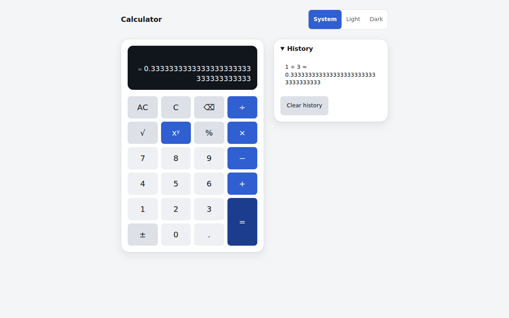
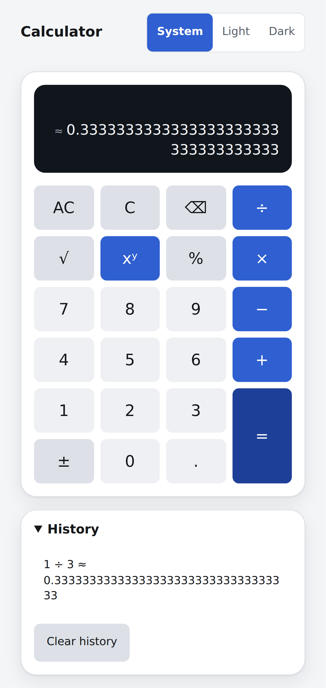

# FullStackCalculator

An arbitrary-precision calculator. A React and TypeScript single-page app delegates **every** calculation to a Go REST service that computes with 34 significant decimal digits, so `0.1 + 0.2` reads `0.3` and `1 ÷ 3` is shown as a rounded value marked `≈`. The service has a contract-first OpenAPI 3.1 API with RFC 9457 error responses, structured logs, Prometheus-format metrics and drain-aware probes. It runs as two containers behind an nginx edge or as one all-in-one container, with the checks, images and documentation of a production service.

## Overview





Both screenshots come from the running app (System theme on a light OS, after pressing `1`, `÷`, `3`, `=`): 1280 × 800 on a desktop and a Pixel 7 on a phone, where the history panel is collapsed until its summary is opened.

- **Server-authoritative arithmetic.** The browser never computes a result. Numbers travel as decimal strings, the service rounds half-even to 34 significant digits and reports `inexact: true` when it had to round.
- **One contract.** `backend/api/openapi.yaml` is the single source of truth; the service embeds it, the contract tests validate every response against it and the frontend types are generated from it.
- **Two delivery topologies.** Split (`web` nginx edge plus `api`) and all-in-one (one binary with the app embedded), non-root images that Compose and `make run-aio` run read-only with all capabilities dropped.

## Features

**Calculator app**

- Seven operations: add (`+`), subtract (`−`), multiply (`×`), divide (`÷`), power (`^`), square root (`√`) and percentage (`%`).
- A 4 × 6 keypad of native buttons and a full keyboard map: digits, `.` or `,`, `+ - * / ^`, `%`, `r` (square root), `n` (change sign), `Enter` or `=`, `Backspace`, `Delete` (clear entry) and `Escape` (all clear).
- Sequential chaining (`2 + 3 × 4 =` gives 20, `5 + =` gives 10, `2 + × 3 =` gives 6); the app does not parse expressions.
- Exact entry editing, thousands grouping, a real minus sign, `≈` on rounded results with an accessible explanation, and clear messages for every error with a `Ref` that equals the response's `X-Request-ID`.
- History of the last 20 successful calculations, kept in the browser (`localStorage`), recalled with one press and cleared with `Clear history`.
- Themes System, Light and Dark, applied before the first paint without inline scripts.
- WCAG 2.2 AA: keypad buttons named `AC, all clear`, `clear entry`, `backspace`, `xʸ, power` and so on, touch targets of at least 48 × 48 px, visible focus, text contrast of at least 4.5:1 in both themes, reduced-motion support, zero axe violations, no horizontal scroll at 320 px.

**API and service**

- `GET /api/v1/operations`, `POST /api/v1/operations/{operation}`, `GET /api/v1/openapi.yaml`, `GET /healthz`, `GET /readyz`.
- Operands and results are decimal strings of at most 128 characters and 34 significant digits, with magnitudes from `1e-6143` to `1e6144`.
- Thirteen stable problem codes, `X-Request-ID` propagation, bounded request bodies (4096 bytes) and headers (16 KiB).
- Environment-only configuration, graceful shutdown with a readiness drain, a private admin listener for metrics and optional pprof.

**Delivery**

- An nginx edge that serves the app, proxies the API, owns the browser security policy (CSP and friends), rate-limits, gzips text and answers its own failures with the same problem format.
- Three small images (`calculator-api`, `calculator-web`, `calculator`), a Compose stack with health checks and a single `Makefile` entrypoint.

## Quick start

### Prerequisites

| Route | You need |
|---|---|
| Split stack, all-in-one | Docker with Compose v2 (`docker compose up --wait`) and GNU Make |
| Local development | Go 1.27, Node 24 with pnpm 10 (`corepack enable pnpm`), GNU Make |

For local development run `make bootstrap` once. It checks that Go, Node and pnpm are present and names the one that is missing, installs the pinned tools (checksum-verified) into the git-ignored `bin/`, downloads the Go modules, installs the frontend dependencies from the lockfile and installs the Playwright Chromium browser. Running it again is safe.

### 1. Split stack (nginx edge and API)

```bash
make up
```

This builds the images, starts `api` and `web`, and waits until both are healthy. Open <http://localhost:8080>. Only `web` publishes a port; the API and its admin listener stay on the private Compose network.

```bash
make logs      # follow the logs of both services
make down      # remove the stack and orphan containers
```

If port 8080 is busy, pick another one for every command: `WEB_PORT=18080 make up`.

If you stop the `api` container, restore it with `make up` (a full `docker compose up`), never with `docker start` or `docker compose up api`: nginx resolves the upstream address once at start, and a full `docker compose up` restarts `web` (its dependency on `api` is declared with `restart: true`) when it brings `api` back at a new address.

### 2. All-in-one container

```bash
make image-aio    # builds calculator:local
make run-aio      # runs it in the foreground, read-only, all capabilities dropped
```

Open <http://localhost:8080>. One Go binary serves the app, the API, the browser policy headers and the cache headers on a single port. It uses the same port as the split stack: stop one before starting the other, or choose another port with `WEB_PORT`. Without Make, `docker build -t calculator:local .` and `docker run --rm -p 8080:8080 calculator:local` build and run the same image (the targets add the `VERSION` and `COMMIT` build arguments and the hardening options). `make smoke-aio` starts the hardened container and checks it with curl.

### 3. Local development

Two terminals:

```bash
make dev-backend     # API on :8081, admin listener on :9091
make dev-frontend    # Vite on http://localhost:5173, proxying /api to the API
```

Open <http://localhost:5173>. The proxy keeps the app same-origin, as in the other topologies; set `API_PROXY_TARGET` to point it elsewhere.

### Make targets

`make help` lists every target. The Makefile is the single entrypoint:

| Target | What it does |
|---|---|
| `help` | List available commands |
| `bootstrap` | Install pinned tools, dependencies and the browser |
| `gen` | Generate the API client types |
| `lint` | Check backend, frontend, contract and delivery files |
| `test` | Run backend and frontend tests |
| `coverage` | Generate and gate both coverage reports |
| `coverage-backend` | Generate and gate backend coverage |
| `coverage-frontend` | Generate and gate frontend coverage |
| `fuzz` | Fuzz parsing and calculation |
| `bench` | Record benchmarks and enforce their budgets |
| `dev-backend` | Run the API in the foreground |
| `dev-frontend` | Run the Vite development server in the foreground |
| `up` | Build and start the split stack, waiting for health |
| `down` | Remove the split stack and orphan containers |
| `logs` | Follow the split stack logs |
| `e2e` | Run browser tests against the running split stack |
| `image-aio` | Build the all-in-one image |
| `run-aio` | Run the hardened all-in-one container in the foreground |
| `smoke-aio` | Smoke-test the hardened all-in-one container |
| `docs-api` | Generate the ignored API reference |
| `clean` | Remove generated builds and reports |

## Architecture

### Split topology

```text
                       Docker network (private)
 ┌─────────┐      ┌──────────────────────────────┐      ┌───────────────────────┐
 │ Browser │ ───▶ │ web  (nginx, :8080)          │ ───▶ │ api  (Go, :8081)      │
 └─────────┘      │  serves the built app        │      │  /api/v1/operations…  │
   published      │  proxies /api/, /healthz,    │      │  /healthz  /readyz    │
   port 8080      │  /readyz to api              │      │                       │
                  │  security headers, limits,   │      │ admin (:9091, private)│
                  │  gzip, edge problems         │      │  /metrics  (pprof)    │
                  └──────────────────────────────┘      └───────────────────────┘
```

The edge is the only published service. It serves static files with revalidation (`no-cache`) and content-hashed assets for a year (`immutable`), applies the browser policy to every response, limits API traffic per client address, and turns an unreachable service into a `503` problem. The admin listener is never routed.

### All-in-one topology

```text
 ┌─────────┐      ┌─────────────────────────────────────────────┐
 │ Browser │ ───▶ │ calculator  (one Go binary, :8080)          │
 └─────────┘      │  embedded app files  +  /api/v1/…  +        │
   published      │  /healthz  /readyz                          │
   port 8080      │  same security and cache headers as the edge│
                  │  admin listener (:9091, not published)      │
                  └─────────────────────────────────────────────┘
```

The binary is built with the `embedui` tag, so the compiled app is part of the executable. It has no compression and none of the edge's rate limits; the edge adds those in the split topology.

### Code structure

- **Backend** (`backend/`): `internal/calc` is the pure decimal engine (no HTTP); `internal/httpapi` holds the handlers and routes and depends on the engine through a small interface it defines; `internal/platform/httpx` has the middleware, problem details and request decoding; `internal/observability` has logging and metrics; `internal/config` loads and validates the environment; `internal/app` wires the listeners and the lifecycle; `internal/web` serves the embedded app.
- **Frontend** (`frontend/`): a pure reducer state machine in `src/features/calculator/model`, hooks for keyboard, history and delayed busy state, presentational components in `ui`, and a typed API client generated from the contract in `src/shared/api`.

## API usage

The examples use the address of the split stack and of the all-in-one container, `http://localhost:8080`. Against `make dev-backend` (the service alone, no edge) use `http://localhost:8081`: the bodies are the same, but the edge's security headers, compression and limits exist only on port 8080. Each command sends `X-Request-ID: demo-1` so that the response is reproducible: the service echoes a valid inbound id and puts it in every problem's `requestId`. Without the header the service generates one.

Numbers are strings. `"inexact": true` means the exact result had to be rounded to 34 significant digits.

### List the operations

```bash
curl -sS -H 'X-Request-ID: demo-1' http://localhost:8080/api/v1/operations
```

Response `200`:

```json
{"operations":[{"name":"add","symbol":"+","arity":2,"description":"Sum of two numbers"},{"name":"subtract","symbol":"−","arity":2,"description":"Difference of two numbers"},{"name":"multiply","symbol":"×","arity":2,"description":"Product of two numbers"},{"name":"divide","symbol":"÷","arity":2,"description":"Quotient of two numbers"},{"name":"power","symbol":"^","arity":2,"description":"First number raised to the power of the second"},{"name":"sqrt","symbol":"√","arity":1,"description":"Principal square root"},{"name":"percentage","symbol":"%","arity":1,"description":"Value divided by one hundred"}]}
```

### The seven operations

Binary operations (`add`, `subtract`, `multiply`, `divide`, `power`) take exactly two operands; `sqrt` and `percentage` take exactly one.

**add**: exact decimal arithmetic.

```bash
curl -sS -H 'X-Request-ID: demo-1' -H 'Content-Type: application/json' \
  -d '{"operands":["0.1","0.2"]}' http://localhost:8080/api/v1/operations/add
```

Response `200`:

```json
{"operation":"add","operands":["0.1","0.2"],"result":"0.3","inexact":false}
```

**subtract**

```bash
curl -sS -H 'X-Request-ID: demo-1' -H 'Content-Type: application/json' \
  -d '{"operands":["10","4"]}' http://localhost:8080/api/v1/operations/subtract
```

Response `200`:

```json
{"operation":"subtract","operands":["10","4"],"result":"6","inexact":false}
```

**multiply**

```bash
curl -sS -H 'X-Request-ID: demo-1' -H 'Content-Type: application/json' \
  -d '{"operands":["12.5","4"]}' http://localhost:8080/api/v1/operations/multiply
```

Response `200`:

```json
{"operation":"multiply","operands":["12.5","4"],"result":"50","inexact":false}
```

**divide**: a repeating fraction is rounded and flagged.

```bash
curl -sS -H 'X-Request-ID: demo-1' -H 'Content-Type: application/json' \
  -d '{"operands":["1","3"]}' http://localhost:8080/api/v1/operations/divide
```

Response `200`:

```json
{"operation":"divide","operands":["1","3"],"result":"0.3333333333333333333333333333333333","inexact":true}
```

**power**

```bash
curl -sS -H 'X-Request-ID: demo-1' -H 'Content-Type: application/json' \
  -d '{"operands":["2","10"]}' http://localhost:8080/api/v1/operations/power
```

Response `200`:

```json
{"operation":"power","operands":["2","10"],"result":"1024","inexact":false}
```

**sqrt**: one operand; an irrational root is rounded and flagged.

```bash
curl -sS -H 'X-Request-ID: demo-1' -H 'Content-Type: application/json' \
  -d '{"operands":["2"]}' http://localhost:8080/api/v1/operations/sqrt
```

Response `200`:

```json
{"operation":"sqrt","operands":["2"],"result":"1.414213562373095048801688724209698","inexact":true}
```

**percentage**: the operand divided by one hundred.

```bash
curl -sS -H 'X-Request-ID: demo-1' -H 'Content-Type: application/json' \
  -d '{"operands":["50"]}' http://localhost:8080/api/v1/operations/percentage
```

Response `200`:

```json
{"operation":"percentage","operands":["50"],"result":"0.5","inexact":false}
```

### Errors

Every error is `application/problem+json` with `type`, `title`, `status`, `detail`, `code`, `requestId` and, for the service, `instance` (the request path). **400** means the request is wrong; **422** means it is well-formed but the mathematics has no representable answer.

**Invalid operand** (400, `VALIDATION_FAILED`, one entry in `errors` per bad operand):

```bash
curl -sS -H 'X-Request-ID: demo-1' -H 'Content-Type: application/json' \
  -d '{"operands":["1","abc"]}' http://localhost:8080/api/v1/operations/add
```

Response `400`:

```json
{"type":"urn:calculator:problem:validation-failed","title":"Validation failed","status":400,"detail":"one or more operands are invalid","instance":"/api/v1/operations/add","code":"VALIDATION_FAILED","requestId":"demo-1","errors":[{"field":"operands[1]","reason":"must be a decimal number in JSON number syntax, e.g. \"-12.5\" or \"1e-3\""}]}
```

**Wrong operand count** (400, `VALIDATION_FAILED`):

```bash
curl -sS -H 'X-Request-ID: demo-1' -H 'Content-Type: application/json' \
  -d '{"operands":["1"]}' http://localhost:8080/api/v1/operations/add
```

Response `400`:

```json
{"type":"urn:calculator:problem:validation-failed","title":"Validation failed","status":400,"detail":"add takes exactly 2 operands, got 1","instance":"/api/v1/operations/add","code":"VALIDATION_FAILED","requestId":"demo-1","errors":[{"field":"operands","reason":"add takes exactly 2 operands, got 1"}]}
```

**Malformed JSON** (400, `MALFORMED_REQUEST`):

```bash
curl -sS -H 'X-Request-ID: demo-1' -H 'Content-Type: application/json' \
  -d '{"operands":["1","2"' http://localhost:8080/api/v1/operations/add
```

Response `400`:

```json
{"type":"urn:calculator:problem:malformed-request","title":"Malformed request","status":400,"detail":"request body is not valid JSON","instance":"/api/v1/operations/add","code":"MALFORMED_REQUEST","requestId":"demo-1"}
```

**Unknown operation** (404, `UNKNOWN_OPERATION`):

```bash
curl -sS -H 'X-Request-ID: demo-1' -H 'Content-Type: application/json' \
  -d '{"operands":["1","2"]}' http://localhost:8080/api/v1/operations/modulo
```

Response `404`:

```json
{"type":"urn:calculator:problem:unknown-operation","title":"Unknown operation","status":404,"detail":"operation \"modulo\" is not supported; see GET /api/v1/operations","instance":"/api/v1/operations/modulo","code":"UNKNOWN_OPERATION","requestId":"demo-1"}
```

**Unknown route** (404, `NOT_FOUND`; every unmatched path under `/api/` is a problem, never HTML):

```bash
curl -sS -H 'X-Request-ID: demo-1' http://localhost:8080/api/v1/nothing
```

Response `404`:

```json
{"type":"urn:calculator:problem:not-found","title":"Not found","status":404,"detail":"no route matches the request method and path","instance":"/api/v1/nothing","code":"NOT_FOUND","requestId":"demo-1"}
```

**Wrong method** (405, `METHOD_NOT_ALLOWED`; the response also carries `Allow: GET`):

```bash
curl -sS -X DELETE -H 'X-Request-ID: demo-1' http://localhost:8080/api/v1/operations
```

Response `405`:

```json
{"type":"urn:calculator:problem:method-not-allowed","title":"Method not allowed","status":405,"detail":"DELETE is not allowed; use GET","instance":"/api/v1/operations","code":"METHOD_NOT_ALLOWED","requestId":"demo-1"}
```

**Wrong media type** (415, `UNSUPPORTED_MEDIA_TYPE`):

```bash
curl -sS -H 'X-Request-ID: demo-1' -H 'Content-Type: text/plain' \
  -d '{"operands":["1","2"]}' http://localhost:8080/api/v1/operations/add
```

Response `415`:

```json
{"type":"urn:calculator:problem:unsupported-media-type","title":"Unsupported media type","status":415,"detail":"Content-Type must be application/json","instance":"/api/v1/operations/add","code":"UNSUPPORTED_MEDIA_TYPE","requestId":"demo-1"}
```

**Body too large** (413, `PAYLOAD_TOO_LARGE`; the service accepts at most 4096 bytes, the edge answers with the same problem above 1 MiB):

```bash
printf '{"operands":["%05000d"]}' 0 | curl -sS -H 'X-Request-ID: demo-1' \
  -H 'Content-Type: application/json' --data-binary @- http://localhost:8080/api/v1/operations/add
```

Response `413`:

```json
{"type":"urn:calculator:problem:payload-too-large","title":"Payload too large","status":413,"detail":"request body must not exceed 4096 bytes","instance":"/api/v1/operations/add","code":"PAYLOAD_TOO_LARGE","requestId":"demo-1"}
```

**Division by zero** (422, `DIVISION_BY_ZERO`):

```bash
curl -sS -H 'X-Request-ID: demo-1' -H 'Content-Type: application/json' \
  -d '{"operands":["1","0"]}' http://localhost:8080/api/v1/operations/divide
```

Response `422`:

```json
{"type":"urn:calculator:problem:division-by-zero","title":"Division by zero","status":422,"detail":"the divisor must not be zero","instance":"/api/v1/operations/divide","code":"DIVISION_BY_ZERO","requestId":"demo-1"}
```

**Undefined result** (422, `UNDEFINED_RESULT`):

```bash
curl -sS -H 'X-Request-ID: demo-1' -H 'Content-Type: application/json' \
  -d '{"operands":["-1"]}' http://localhost:8080/api/v1/operations/sqrt
```

Response `422`:

```json
{"type":"urn:calculator:problem:undefined-result","title":"Undefined result","status":422,"detail":"square root of a negative number is not a real number","instance":"/api/v1/operations/sqrt","code":"UNDEFINED_RESULT","requestId":"demo-1"}
```

**Result out of range** (422, `OVERFLOW`):

```bash
curl -sS -H 'X-Request-ID: demo-1' -H 'Content-Type: application/json' \
  -d '{"operands":["10","99999"]}' http://localhost:8080/api/v1/operations/power
```

Response `422`:

```json
{"type":"urn:calculator:problem:overflow","title":"Result out of range","status":422,"detail":"the result is outside the supported range (1e-6143 … 1e6144)","instance":"/api/v1/operations/power","code":"OVERFLOW","requestId":"demo-1"}
```

### Probes

```bash
curl -sS http://localhost:8080/healthz
```

Response `200` (`version` and `commit` depend on the build):

```json
{"status":"ok","version":"dev","commit":"unknown"}
```

`GET /readyz` answers `{"status":"ready",…}` with `200` while serving and `{"status":"draining",…}` with `503` while the instance drains before shutdown. Behind the edge, an unreachable service makes both probes answer the edge's `SERVICE_UNAVAILABLE` problem.

### Problem catalog

| Code | Status | Title | Emitted by |
|---|---|---|---|
| `MALFORMED_REQUEST` | 400 | Malformed request | service |
| `VALIDATION_FAILED` | 400 | Validation failed | service |
| `NOT_FOUND` | 404 | Not found | service |
| `UNKNOWN_OPERATION` | 404 | Unknown operation | service |
| `METHOD_NOT_ALLOWED` | 405 | Method not allowed | service |
| `PAYLOAD_TOO_LARGE` | 413 | Payload too large | service (body over 4096 bytes) and edge (body over 1 MiB, probes over 16 KiB) |
| `UNSUPPORTED_MEDIA_TYPE` | 415 | Unsupported media type | service |
| `DIVISION_BY_ZERO` | 422 | Division by zero | service |
| `UNDEFINED_RESULT` | 422 | Undefined result | service |
| `OVERFLOW` | 422 | Result out of range | service |
| `RATE_LIMITED` | 429 | Too many requests | edge |
| `INTERNAL_ERROR` | 500 | Internal server error | service |
| `SERVICE_UNAVAILABLE` | 503 | Service unavailable | edge |

The contract (`backend/api/openapi.yaml`) lists the same codes in the `ProblemCode` enum. The interactive reference is generated with `make docs-api`; see `docs/api/README.md`.

## Design decisions

Each decision is recorded as an ADR with its context, consequences and rejected alternatives.

| ADR | Decision | Status |
|---|---|---|
| [0001](docs/adr/0001-monorepo-and-independent-services.md) | Monorepo with independently deployable services | Accepted |
| [0002](docs/adr/0002-decimal-arithmetic-and-string-numbers.md) | Decimal arithmetic and decimal strings on the wire | Accepted |
| [0003](docs/adr/0003-provider-owned-openapi-contract.md) | Provider-owned OpenAPI contract | Accepted |
| [0004](docs/adr/0004-problem-details-and-status-semantics.md) | Problem details and status semantics | Accepted |
| [0005](docs/adr/0005-stdlib-http-and-consumer-interfaces.md) | Standard-library HTTP and consumer-defined interfaces | Accepted |
| [0006](docs/adr/0006-server-arithmetic-and-pure-reducer.md) | Server-authoritative arithmetic and a pure reducer | Accepted |
| [0007](docs/adr/0007-split-and-embedded-delivery.md) | Split and embedded delivery | Accepted |
| [0008](docs/adr/0008-observability-and-drain-aware-readiness.md) | Observability and drain-aware readiness | Accepted |

The index is [docs/adr/README.md](docs/adr/README.md). Requirements and use cases are in `docs/spec/`.

## Testing & coverage

All figures below were measured at revision `5a00a5d` on one machine (4 CPUs, 14 GB RAM, WSL2, Go 1.27.3, Node 24.22.1) on 2026-10-22. The commands, durations and raw results are in [docs/verification.md](docs/verification.md).

```bash
make test               # backend (race detector, shuffled) and frontend unit and component tests
make coverage           # both coverage reports, gated; HTML under coverage/
make fuzz               # FuzzParse and FuzzCalculate, 30 s each
make bench              # benchmarks, with their budgets enforced
make lint               # Go, TypeScript, contract, Dockerfile, workflow and shell checks
make up && make e2e     # browser tests against the running split stack
```

### Coverage

| Area | Gate | Measured |
|---|---|---|
| Backend (`./internal/...`, statements) | 90 % | 98.11 % (782 of 797 statements) |
| Frontend statements | 90 % | 99.77 % |
| Frontend branches | 85 % | 100 % |
| Frontend functions | 90 % | 99.15 % |
| Frontend lines | 90 % | 100 % |

The frontend run has 1,342 tests in 34 files. The reports are `coverage/backend/index.html` and `coverage/frontend/index.html` (git-ignored).

### Benchmarks

Median of three samples, in ns/op. Every `BenchmarkCalculate` case must stay under 1,000,000 ns/op and every `BenchmarkCalculateWorstCase` case (powers with operands at the edges of the range) under 50,000,000 ns/op; `make bench` fails otherwise.

| Case | Median ns/op | Budget ns/op |
|---|---|---|
| `BenchmarkCalculate/add` | 1,536 | 1,000,000 |
| `BenchmarkCalculate/divide_repeating` | 1,697 | 1,000,000 |
| `BenchmarkCalculate/sqrt_irrational` | 8,590 | 1,000,000 |
| `BenchmarkCalculate/power_overflow` | 20,821 | 1,000,000 |
| `BenchmarkCalculate/power_large_integer` | 65,379 | 1,000,000 |
| `BenchmarkCalculate/power_fractional` | 290,082 | 1,000,000 |
| `BenchmarkCalculateWorstCase/max^0.5` | 3,945,532 | 50,000,000 |
| `BenchmarkCalculateWorstCase/(-1)^1e6144` | 4,332,797 | 50,000,000 |
| `BenchmarkCalculateWorstCase/min^0.5` | 4,513,705 | 50,000,000 |
| `BenchmarkCalculateWorstCase/min^0.99…9` | 9,349,798 | 50,000,000 |
| `BenchmarkCalculateWorstCase/1.5e-6143^-0.99…9` | 11,037,900 | 50,000,000 |
| `BenchmarkCalculateWorstCase/max^0.99…9` | 12,889,222 | 50,000,000 |
| `BenchmarkCalculateWorstCase/max^-0.99…9` | 12,956,672 | 50,000,000 |

### Browser tests, fuzzing and the composed stack

The Playwright suite runs against the real composed stack in two projects, `chromium` (desktop) and `mobile-chromium` (Pixel 7). It covers the seven operations through the UI with the real request asserted, chaining, errors with their `Ref`, editing, history, themes and the theme bootstrap under the real CSP, keyboard input, accessibility (axe, zero violations in both themes), layout at 320, 393, 768 and 1280 px, the security headers and the edge against the real service. The recorded run: 186 passed and 1 skipped (a touch-only test) on `chromium`, 187 passed on `mobile-chromium`, and 6 passed in the specs that disturb the stack (held connections, rate bursts, the drain window, replacing `api`). `make fuzz` ran both targets for 30 s each with no panics. The all-in-one smoke ran 58 checks with no failures.

### Durations

Measured wall-clock times on the same machine (warm caches unless stated); every local command stays under ten minutes.

| Command | Duration |
|---|---|
| `make coverage-backend` | 7.2 s warm (51.8 s cold) |
| `make coverage-frontend` | 53.2 s |
| `make fuzz` | 1 min 5 s |
| `make bench` | 54.3 s |
| `make lint` | 47.3 s |
| `make up` (images cached) | 16.8 s |
| `make e2e` on `chromium` | 4 min 8 s |
| `make e2e` on `mobile-chromium` | 4 min 9 s |
| `make e2e`, specs that disturb the stack | 1 min 10 s |
| `make image-aio` | 6.3 s |
| `make smoke-aio` | 9.5 s |
| `make docs-api` | 1.1 s |

### Image sizes

The API image is expected to stay under 20 MB. The size has three readings, and each is named:

| Image | Layer sum | Compressed content | `docker images` listing |
|---|---|---|---|
| `calculator-api` | 16.5 MB | 5.3 MB | 21.8 MB |
| `calculator` (all-in-one) | 18.0 MB | 5.6 MB | 23.7 MB |
| `calculator-web` | 66.1 MB | 25.9 MB | 92 MB |

The reading against the 20 MB expectation is the sum of the image layers (16.5 MB for the API image). The compressed content is what a registry transfers; the `docker images` listing includes the snapshot accounting of Docker's containerd image store.

### Test tiers

`scripts/ci/t0.sh` to `t3.sh` are the local tiers: tier 0 checks the changed files and the packages they affect, tier 1 runs exactly the tests or Make targets you name, tier 2 checks the affected stages in full and runs the stages you select by name with `--stage` (images, the composed stack, E2E and the all-in-one smoke are selected that way), and tier 3 runs the CI checks, whole or one job at a time (`--job <name>`). Each prints every command with its duration and stops at the first failure.

## Configuration

The service reads **environment variables only**. Every invalid value is reported at once and the process exits non-zero. The remaining variables configure the Make targets, the Compose stack, the development servers and the edge image.

| Variable | Read by | Default | Meaning |
|---|---|---|---|
| `CALC_HTTP_ADDR` | service | `:8081` | Public listener, `host:port` (the all-in-one image sets `:8080`) |
| `CALC_ADMIN_ADDR` | service | `:9091` | Private listener for `/metrics` and optional pprof; an empty value disables it |
| `CALC_LOG_LEVEL` | service | `info` | `debug`, `info`, `warn` or `error` |
| `CALC_LOG_FORMAT` | service | `json` | `json` or `text` |
| `CALC_SHUTDOWN_TIMEOUT` | service | `15s` | Time allowed to finish in-flight requests and close the listeners once the drain is over; must be positive |
| `CALC_SHUTDOWN_DRAIN` | service | `0s` | Time readiness answers 503 before the listeners close (Compose sets `2s`); zero or more |
| `CALC_PPROF` | service | `false` | Serve `/debug/pprof/` on the admin listener |
| `API_PROXY_TARGET` | Vite dev server | `http://localhost:8081` | Where the dev server proxies `/api` |
| `VITE_PORT` | Vite dev server | `5173` | Dev server port |
| `API_UPSTREAM` | web image | `api:8081` | `host:port` of the service behind the edge |
| `WEB_PORT` | Compose, Make | `8080` | Host port of the published `web` service and of the all-in-one container |
| `VERSION` | Make, image builds | `git describe --tags --always --dirty`, else `dev` | Reported by `/healthz` and `calculator_build_info` |
| `COMMIT` | Make, image builds | `git rev-parse HEAD`, else `unknown` | Reported by `/healthz` and `calculator_build_info` |
| `COMPOSE_PROJECT_NAME` | Compose, Make | `fullstackcalculator` | Compose project name; through Make, other names also get image tags of their own |
| `IMAGE_TAG` | Compose, Make | `local` | Tag of the locally built images; Make sets it from `COMPOSE_PROJECT_NAME` when that is not the default |
| `AIO_IMAGE` | Make | `calculator:$(IMAGE_TAG)` | Name of the all-in-one image |
| `AIO_NAME` | Make | `$(COMPOSE_PROJECT_NAME)-aio` | Name of the all-in-one container |
| `E2E_BASE_URL` | Make, Playwright | `http://127.0.0.1:$(WEB_PORT)` | Where the browser tests look for the stack (derived from `WEB_PORT`) |
| `E2E_ARGS` | Make | — | Extra arguments for `playwright test`, for example `--project=chromium` |
| `FUZZTIME` | Make | `30s` | Duration of each fuzz target |
| `CI_STAGE_TIMEOUT` | `scripts/ci` tiers | `600` | Seconds a `t2.sh` stage may run before it is stopped; lower it to tighten the bound |
| `E2E_STACK` | Playwright | — | `1` selects only the specs that disturb the stack (stop, recreate, flood); run it alone and last, for example `E2E_STACK=1 make e2e E2E_ARGS="--project=chromium e2e/stack-disruptive.spec.ts"` |
| `E2E_COMPOSE_OVERRIDE` | Playwright | — | Path of an extra Compose file the disruptive specs add when they recreate `api` |

Copy `.env.example` to `.env` (git-ignored) to override the defaults for Compose; export variables in your shell for the Make and development commands. All values are non-secret.

## Observability

- **Logs.** One structured line per request through `log/slog`, in JSON (or text with `CALC_LOG_FORMAT=text`). Fields: `method`, `route` (the matched pattern, never the raw path), `path`, `status`, `bytes`, `duration_ms`, `remote_addr`, `user_agent` and `request_id`; `method`, `path` and `user_agent` are cut at 256 characters. Server errors (5xx) are logged at `error`, everything else, including the draining readiness 503, at `info`.

  ```json
  {"time":"2026-10-22T17:35:24.57-05:00","level":"INFO","msg":"http request","method":"POST","route":"/api/v1/operations/{operation}","path":"/api/v1/operations/add","status":200,"bytes":76,"duration_ms":0.124,"remote_addr":"[::1]:50534","user_agent":"curl/8.5.0","request_id":"demo-1"}
  ```

- **Request IDs.** Every response carries `X-Request-ID`. A valid inbound value (`[A-Za-z0-9._-]`, up to 128 characters) is kept, anything else is replaced by a generated one; a problem's `requestId` equals the header and the UI shows it as `Ref`. The edge propagates the same validated id to the service.
- **Metrics.** The admin listener serves `GET /metrics` in Prometheus text format from a dedicated registry (Go and process collectors included): `http_requests_total{method,route,status}`, `http_request_duration_seconds{method,route}`, `http_requests_in_flight`, `calculator_operations_total{operation,outcome}` and `calculator_build_info{version,commit,go_version}`. Labels are bounded: unknown methods become `OTHER`, unknown operations `unknown`, routes are patterns. In the split stack the admin listener is private by design; try it with `make dev-backend` and `curl -sS http://localhost:9091/metrics`.
- **pprof.** `/debug/pprof/` exists on the admin listener only with `CALC_PPROF=true`. Metrics and pprof are never served on the public listener or proxied by the edge.
- **Probes.** `GET /healthz` is liveness and never depends on anything else. `GET /readyz` is readiness and answers `503` with `"status":"draining"` once a shutdown signal arrives; after `CALC_SHUTDOWN_DRAIN` the listeners close within `CALC_SHUTDOWN_TIMEOUT`. The two Go images use `/calculator healthcheck`, which probes `/healthz` on the local port (distroless images have no curl); the web image probes the edge's own `/nginx-health` with `wget`.
- **Build information.** `VERSION` and `COMMIT` are injected at build time and appear in `/healthz` and `calculator_build_info`; without them `COMMIT` falls back to the embedded VCS revision (its first 12 characters) and `VERSION` to `dev`.

## CI/CD

The pipeline is defined in `.github/workflows/ci.yml.disabled`. It is committed **disabled**: GitHub runs only `*.yml` and `*.yaml` files, and renaming it to `ci.yml` (`git mv .github/workflows/ci.yml.disabled .github/workflows/ci.yml`) enables it, which is the repository owner's decision. There is no status badge and no link to a hosted page.

- **Triggers:** pull requests, pushes to `main`, tags `v*` and manual dispatch. Runs are grouped per pull request or ref (a manual dispatch has its own group), and a superseded pull-request run is cancelled; a run on `main` or on a tag is never cancelled while it may publish.
- **Jobs:** `contract` (Redocly lint, type regeneration with drift failure, `make docs-api`, workflow lint and structure check, shell lint, tests of the publish tag rules), `backend` (module checks, vet, golangci-lint, `make coverage-backend`, `make fuzz`, `make bench`, govulncheck, build), `frontend` (typecheck, ESLint, Prettier, `make coverage-frontend`, build, `pnpm audit --prod --audit-level high`), `e2e` (`make up`, `make e2e` on both browser projects, the disruptive specs that stop and recreate containers, container logs kept on failure, `make down`), `images` (hadolint, Compose config, the three images built and smoke-tested, the web image also against a stub of the service, export of the three image archives, vulnerability scan of fixable high and critical findings in each) and `publish`.
- **Publishing:** the `publish` job needs every other job, runs only on a push to `main` (not in a fork) or on a validated `vX.Y.Z` tag reachable from `main`, and pushes the exact tested images (`calculator-api`, `calculator-web`, `calculator`) to the GitHub Container Registry under the repository owner's namespace. Tags: `sha-<full 40-character SHA>` always, `main` on pushes to `main`, and `X.Y.Z` (without the leading `v`) for a release tag `vX.Y.Z`. A re-run for a commit that is no longer the tip of `main` publishes only its `sha-` tag, so `main` never moves back, and an existing `X.Y.Z` is never overwritten. It is the only job with `packages: write`; everything else has `contents: read`.
- **Supply chain:** actions are pinned to full commit SHAs, base images by tag and digest, standalone tools in `tools/versions.env` with checksums. Dependabot ([`.github/dependabot.yml`](.github/dependabot.yml)) proposes weekly updates, minor and patch grouped and major versions separately, for the Go module (`/backend`), npm (`/frontend`), the Dockerfiles (`/`, `/backend`, `/frontend`) and GitHub Actions (`/`). Dependabot reads only `.yml` and `.yaml` workflow files, so while the workflow is disabled its action pins are updated by hand; the standalone tools in `tools/versions.env` and the Node version in `frontend/.node-version` are also bumped by hand.
- **Same checks locally.** The jobs use the same Make targets and `scripts/ci` scripts as the local tiers (`scripts/ci/t3.sh --job <name>` runs a job's checks), so a CI failure can be reproduced with the same command. The image checks live in [`scripts/ci/image-smoke.sh`](scripts/ci/image-smoke.sh) (API image) and [`scripts/ci/edge-smoke.sh`](scripts/ci/edge-smoke.sh) (web image in front of the API image); [`scripts/ci/edge-stub-smoke.sh`](scripts/ci/edge-stub-smoke.sh) and [`scripts/ci/edge-mutations.sh`](scripts/ci/edge-mutations.sh) check the edge configuration against a stub of the service, and [`scripts/ci/publish-tags.sh`](scripts/ci/publish-tags.sh) validates the release tag rules.

## Project layout

```text
backend/                    Go service (module github.com/JerikH/FullStackCalculator/backend)
  api/                      openapi.yaml, the contract, and spec.go that embeds it
  cmd/calculator/           main package
  internal/                 app, buildinfo, calc, config, httpapi, observability, platform/httpx, web
  Dockerfile                calculator-api image
frontend/                   React + TypeScript app (Vite)
  src/features/calculator/  model (reducer), hooks, ui
  src/app/                  application shell
  src/shared/               api client, storage, styles, theme, small UI helpers
  e2e/                      Playwright specs against the composed stack
  Dockerfile                calculator-web image (nginx edge)
deploy/nginx/               edge configuration template and header snippets
scripts/                    bootstrap, coverage and benchmark gates, all-in-one smoke test
scripts/ci/                 environment (env.sh), local tiers t0–t3, shared library, tool installer
tools/versions.env          pinned standalone tools
docs/adr/                   architecture decision records
docs/api/                   API reference notes (make docs-api generates the page)
docs/assets/                README screenshots
docs/spec/                  requirements, use cases, roadmap
docs/state/                 run records and findings
docs/verification.md        dated verification evidence
.github/workflows/          CI definition (disabled)
Dockerfile                  calculator all-in-one image
compose.yaml                split stack
Makefile                    single entrypoint
redocly.yaml                contract lint rules
PRODUCT.md, DESIGN.md       product and design baseline of the UI
```

Licensed under the MIT license (`LICENSE`).

## Trade-offs & future work

**Design exclusions**

- **No CORS.** Every topology is same-origin (the edge, the embedded app and the Vite proxy), so the API sends no cross-origin headers.
- **No user accounts.** History lives in the browser. Each tab keeps its own copy of the history state and the last writer wins: there is no `storage` listener, so a second tab does not see changes until it reloads.
- **No expression parsing.** Operations chain sequentially (`2 + 3 × 4 =` is 20).
- **No distributed rate limiting.** The limit is per edge instance: 20 requests per second with a burst of 40, and 20 concurrent API connections, per client address.
- **No localisation.** The UI and the API messages are English.

**Operational trade-offs**

- The edge keys its limits on the address nginx sees. Behind Docker's userland proxy (the default for ports published on 127.0.0.1, rootless Docker and Docker Desktop) every local client arrives as the bridge gateway, so all of them share one 20 requests-per-second budget and one 20-connection limit: a single local client holding 20 slow requests can make the edge refuse the others on `/api/` with `RATE_LIMITED`, while `/`, `/nginx-health` and the probes keep answering. Forwarded-address headers are deliberately not trusted.
- The all-in-one image serves the app bundle uncompressed; only the nginx edge compresses text responses. Its layers sum to 18.0 MB (the API image is 16.5 MB, 5.3 MB compressed).
- A stopped `api` is restored with `make up`, not `docker start`: nginx resolves the upstream address once, so `web` must restart when Compose recreates `api`.
- Local verification is intentionally short: complete suites, the clean-clone build and the hosted run of the six jobs, both browser projects included, belong to CI once the owner enables it. The scan of the three images ran once locally (fixable high and critical findings: none) and runs in CI on every build.

**Natural extensions**

- Expression parsing on top of the existing operations.
- A shared history, for example per account, in place of the per-browser one.
- Multi-architecture images (the CI definition builds and publishes linux/amd64 only).
